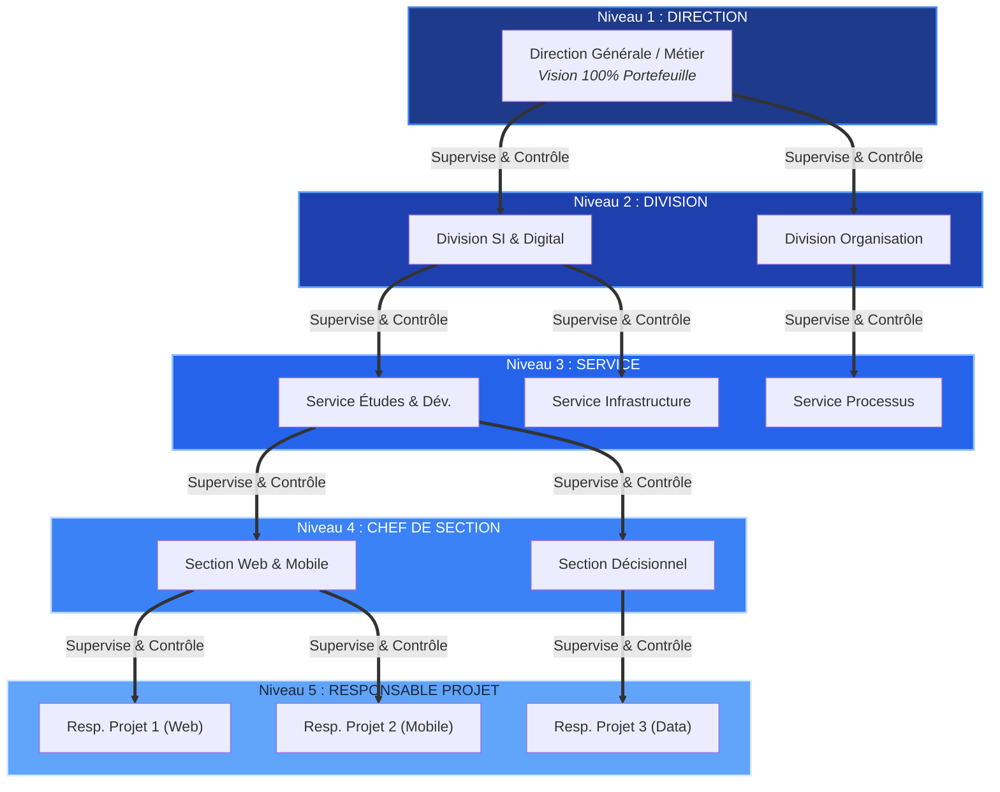
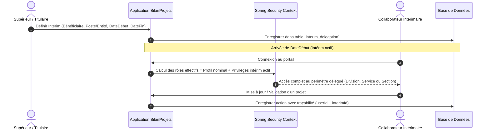
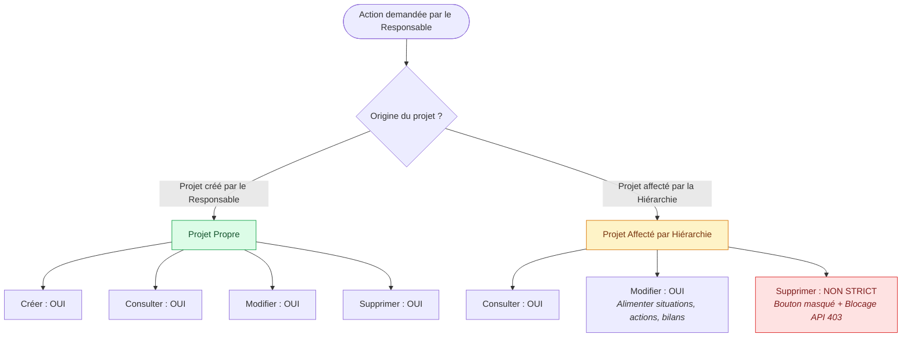
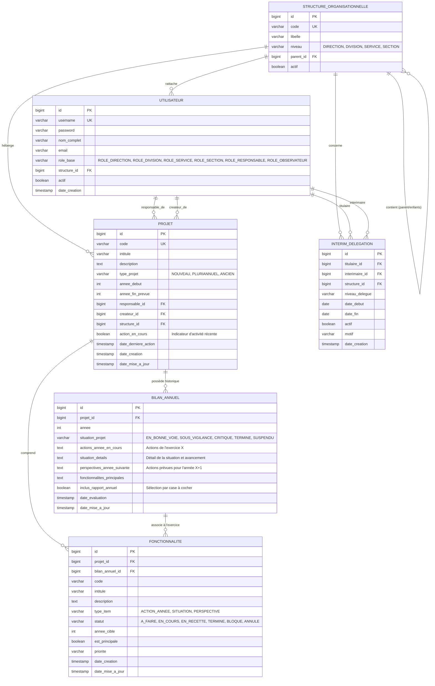

# 📘 Spécification Fonctionnelle et Technique (SFT) - Version 2.0
## Application : Gouvernance, Hiérarchie & Bilan Annuel des Projets (BilanProjets)

* **Version du document :** 2.0.0
* **Date de mise à jour :** Novembre 2026
* **Statut :** Validé / En cours d'implémentation
* **Framework applicatif :** Spring Boot 3.1.3 (Java 17 / 21 LTS)
* **Base de données :** MySQL 8.0+ / H2 (profil dev compatible)
* **Emplacement du projet :** `E:\workspace\git_projets\git_notes`
* **Dépôt Git :** Branche `master`

---

## Sommaire

1. [Contexte, Enjeux & Nouveaux Objectifs](#1-contexte-enjeux--nouveaux-objectifs)
2. [Matrice de Traçabilité des Exigences](#2-matrice-de-traçabilité-des-exigences)
3. [Arborescence Organisationnelle & Visibilité Hiérarchique](#3-arborescence-organisationnelle--visibilité-hiérarchique)
4. [Gestion des Intérims & Délégation Dynamique des Privilèges](#4-gestion-des-intérims--délégation-dynamique-des-privilèges)
5. [Matrice des Droits d'Accès & Habilitations (RBAC / ABAC)](#5-matrice-des-droits-daccès--habilitations-rbac--abac)
6. [Modèle de Données Enrichi (Entités JPA & MySQL)](#6-modèle-de-données-enrichi-entités-jpa--mysql)
7. [Spécifications Fonctionnelles Détaillées des Modules](#7-spécifications-fonctionnelles-détaillées-des-modules)
   - 7.1 [Portefeuille des Projets : Visibilité, Tri, Alertes & Pagination](#71-portefeuille-des-projets--visibilité-tri-alertes--pagination)
   - 7.2 [Fiche Projet & Cycle de Vie : Propre vs Affecté](#72-fiche-projet--cycle-de-vie--propre-vs-affecté)
   - 7.3 [Synthèse Annuelle & Sélection Granulaire des Projets](#73-synthèse-annuelle--sélection-granulaire-des-projets)
   - 7.4 [Moteur d'Export Word (.docx) & Système d'Aperçu](#74-moteur-dexport-word-docx--système-daperçu)
8. [Spécification des Interfaces Utilisateur (IHM)](#8-spécification-des-interfaces-utilisateur-ihm)
9. [Contrats d'Échange REST (API OpenAPI)](#9-contrats-déchange-rest-api-openapi)
10. [Architecture Technique & Moteur de Génération DOCX](#10-architecture-technique--moteur-de-génération-docx)
11. [Plan de Migration & Roadmap](#11-plan-de-migration--roadmap)

---

## 1. Contexte, Enjeux & Nouveaux Objectifs

L'application **BilanProjets** est le référentiel institutionnel de gouvernance, de pilotage opérationnel et de reporting annuel des portefeuilles de projets. 

Face aux exigences managériales et organisationnelles, la version 2.0 introduit des évolutions majeures :
1. **Pyramide hiérarchique à 5 niveaux** : Implémentation de la cascade stricte `Direction -> Division -> Service -> Chef Section -> Responsable Projet`. Le principe fondamental est l'**héritage descendant complet des privilèges** : le niveau supérieur a tous les privilèges sur les niveaux inférieurs rattachés à sa branche, sans réciprocité ascendante ni visibilité transversale non autorisée.
2. **Délégation d'intérim** : Possibilité de mandater à chaque échelon un utilisateur intérimaire qui hérite temporairement de l'ensemble des privilèges et du périmètre du titulaire.
3. **Contrôle d'intégrité sur les projets du Responsable** :
   - Sur ses **propres projets (créés par lui-même)** : Droits **CRUD complets** (Création, Consultation, Modification, Suppression).
   - Sur les **projets affectés par la hiérarchie (non créés par lui-même)** : Droits stricts de **Consultation et Modification**, avec **interdiction formelle de suppression**.
4. **Liste dynamique, triée, filtrée et paginée** : La liste des projets s'adapte au périmètre hiérarchique de l'utilisateur connecté, triée par défaut par **date de dernière mise à jour décroissante** (ou à défaut par date de création décroissante).
5. **Indicateurs visuels d'alerte / actions récentes** : Notification visuelle immédiate permettant d'identifier les projets ayant fait l'objet d'actions en cours ou de mises à jour récentes.
6. **Synthèse annuelle avec sélection à la carte** : Interface permettant de cocher spécifiquement les projets réalisés ou en cours à intégrer dans le bilan annuel consolidé.
7. **Export Word (.docx) normé avec prévisualisation (Aperçu)** : Génération d'un document Word respectant une structure normalisée par projet (`Titre <<code projet>>`, `Description`, `En cours de l'année X`, `Situation du projet`, `Perspectives année X+1`), précédé d'un aperçu interactif avant génération.

---

## 2. Matrice de Traçabilité des Exigences

| Réf. | Exigence Métier | Description / Spécification | Priorité | Statut |
| :--- | :--- | :--- | :--- | :--- |
| **P1** | Socle Technique | Spring Boot 3.1.3, Java 17/21, Maven Wrapper | Obligatoire | ✅ Réalisé |
| **P2** | Base de données | Persistance MySQL 8.0+ / H2 pour le dev local | Obligatoire | ✅ Réalisé |
| **P3** | Gestion par Exercice | Suivi annuel (ex: 2024, 2025, 2026, 2027) | Obligatoire | ✅ Réalisé |
| **P4** | Fiche Projet Socle | Code unique, intitulé, typologie (Nouveau, Pluriannuel, Ancien) | Obligatoire | ✅ Réalisé |
| **P5** | Statuts Fonctionnalités | Workflow unitaire (`A_FAIRE`, `EN_COURS`, `EN_RECETTE`, `TERMINE`, `BLOQUE`, `ANNULE`) | Obligatoire | ✅ Réalisé |
| **P6** | API REST & Swagger | Documentation interactive OpenAPI 3 | Majeure | ✅ Réalisé |
| **P7** | CORS Permissif | Accès inter-domaines autorisé pour les frontends | Majeure | ✅ Réalisé |
| **N1** | **Visibilité Hiérarchique à 5 Paliers** | Direction > Division > Service > Chef Section > Responsable Projet avec héritage descendant strict | Critique | 🔄 Spécifié v2.0 |
| **N2** | **Gestion des Intérims** | Désignation d'un intérimaire par niveau avec délégation temporaire de tous les privilèges | Critique | 🔄 Spécifié v2.0 |
| **N3** | **Règles CRUD Responsable** | CRUD complet sur projets propres ; Consultation + Modification sans suppression sur projets assignés par la hiérarchie | Critique | 🔄 Spécifié v2.0 |
| **N4** | **Tri & Pagination Liste** | Tri par `date_mise_a_jour DESC` (fallback `date_creation DESC`), pagination serveur et filtres multicritères | Haute | 🔄 Spécifié v2.0 |
| **N5** | **Alertes Actions en Cours** | Badge ou icône de notification sur les projets mis à jour récemment ou avec actions en cours | Haute | 🔄 Spécifié v2.0 |
| **N6** | **Sélection Synthèse Annuelle** | Système de cases à cocher (checkboxes) pour choisir les projets intégrés au bilan | Haute | 🔄 Spécifié v2.0 |
| **N7** | **Aperçu Interactif du Rapport** | Modal / écran d'aperçu dynamique avant téléchargement Word | Haute | 🔄 Spécifié v2.0 |
| **N8** | **Template Word (.docx) Structuré** | Export Word normé : Titre <<code>>, Description, En cours année X, Situation du projet, Perspectives | Critique | 🔄 Spécifié v2.0 |

---

## 3. Arborescence Organisationnelle & Visibilité Hiérarchique

### 3.1 Paliers Hiérarchiques Normés

L'organisation repose sur 5 échelons stricts :
```
[Niveau 1] DIRECTION (Direction Générale ou Centrale)
     │
     └── [Niveau 2] DIVISION (Direction Adjointe / Département / Division)
          │
          └── [Niveau 3] SERVICE (Service Opérationnel)
               │
               └── [Niveau 4] CHEF DE SECTION (Section Spécialisée)
                    │
                    └── [Niveau 5] RESPONSABLE DE PROJET (Chef de Projet Métier/IT)
```

### 3.2 Règles Fondamentales de Visibilité & Habilitation



#### Règles d'Héritage et de Cloisonnement :
1. **Héritage Top-Down (Descendant Intégral)** :
   - Tout niveau supérieur possède la totalité des privilèges de consultation, supervision, affectation et reporting sur l'ensemble des branches et sous-branches qui lui sont subordonnées.
   - La **Direction** supervise l'ensemble des divisions, services, sections et projets de l'entreprise.
   - La **Division** a tous les droits sur ses services subordonnés, leurs sections et leurs projets.
   - Le **Service** a tous les droits sur ses sections rattachées et leurs projets.
   - Le **Chef de Section** supervise l'ensemble des projets des responsables de sa section.
2. **Cloisonnement Ascendant Strict (Bottom-Up Interdit)** :
   - Un utilisateur d'un niveau inférieur ne peut en aucun cas consulter, modifier ou administrer des projets situés en dehors ou au-dessus de sa branche d'appartenance.
3. **Cloisonnement Horizontal (Transversal Interdit)** :
   - Deux divisions, deux services ou deux sections distinctes ne peuvent pas voir leurs projets respectifs, sauf si un rôle transversal d'audit (ex: `OBSERVATEUR_GENERAL`) leur est accordé.

---

## 4. Gestion des Intérims & Délégation Dynamique des Privilèges

### 4.1 Définition et Règles Métier

Pour garantir la continuité de service lors de congés, missions ou absences, un mécanisme d'**intérim** est mis en œuvre à chaque échelon hiérarchique.

1. **Désignation de l'intérimaire :**
   - Un titulaire (ou l'autorité hiérarchique immédiatement supérieure) peut désigner un collaborateur en tant qu'**intérimaire** pour son poste ou pour une entité spécifique.
2. **Périmètre temporel :**
   - Chaque mandat d'intérim dispose d'une date de début (`date_debut`), d'une date de fin (`date_fin`) et d'un indicateur de validité (`actif`).
   - L'activation et la désactivation sont automatiques selon la date système ou manuelles sur révocation anticipée.
3. **Étendue des privilèges :**
   - Pendant la période d'intérim active, l'utilisateur désigné reçoit **l'ensemble des habilitations, visibilités et prérogatives du niveau et du titulaire délégué**.
   - Exemple : Si un Chef de Section assure l'intérim du Chef de Service, il accède à l'ensemble des sections du service et hérite des droits d'arbitrage et de modification du Chef de Service.
4. **Auditabilité et Traçabilité :**
   - Toute opération effectuée sous mandat d'intérim est tracée : le système enregistre l'identifiant réel de l'utilisateur exécutant, avec la mention *"par délégation d'intérim pour [Titulaire / Entité]"*.



---

## 5. Matrice des Droits d'Accès & Habilitations (RBAC / ABAC)

### 5.1 Règle CRUD Distincte pour le Responsable de Projet

Le Responsable de Projet est soumis à une règle de gouvernance stricte distinguant l'origine de création du projet :



### 5.2 Matrice Globale des Privilèges par Rôle

| Fonction / Rôle | Consulter Projets | Créer Projet | Modifier Projets | Supprimer Projets | Affecter Responsable | Valider / Bilan Annuel | Générer Word | Gérer Intérim | Gérer Comptes |
| :--- | :---: | :---: | :---: | :---: | :---: | :---: | :---: | :---: | :---: |
| **Direction (N1)** | 🌍 Tous | 🌍 Tous | 🌍 Tous | 🌍 Tous | 🌍 Tous | 🌍 Tous | 🌍 Tous | 🌍 Tous | 🌍 Tous |
| **Division (N2)** | 🏢 Sa division | 🏢 Sa division | 🏢 Sa division | 🏢 Sa division | 🏢 Sa division | 🏢 Sa division | 🏢 Sa division | 🏢 Sa division | ❌ |
| **Service (N3)** | 🏛️ Son service | 🏛️ Son service | 🏛️ Son service | 🏛️ Son service | 🏛️ Son service | 🏛️ Son service | 🏛️ Son service | 🏛️ Son service | ❌ |
| **Chef Section (N4)**| 📑 Sa section | 📑 Sa section | 📑 Sa section | 📑 Sa section | 📑 Sa section | 📑 Sa section | 📑 Sa section | 📑 Sa section | ❌ |
| **Resp. Projet (N5)**<br>*(Projets propres)* | 👤 Ses projets | 👤 Oui | 👤 Ses projets | 👤 **OUI (CRUD)** | ❌ | 👤 Ses projets | 👤 Ses projets | ❌ | ❌ |
| **Resp. Projet (N5)**<br>*(Projets hiérarchie)*| 👤 Projets assignés| ❌ | 👤 **OUI (Mise à jour)**| 🚫 **INTERDIT** | ❌ | 👤 Projets assignés| 👤 Projets assignés| ❌ | ❌ |
| **Intérimaire Actif**| ⚡ Droits du niveau | ⚡ Droits du niveau | ⚡ Droits du niveau | ⚡ Droits du niveau | ⚡ Droits du niveau | ⚡ Droits du niveau | ⚡ Droits du niveau | ❌ | ❌ |
| **Observateur** | 👁️ Lecture seule | ❌ | ❌ | ❌ | ❌ | ❌ | 👁️ Aperçu seul | ❌ | ❌ |

---

## 6. Modèle de Données Enrichi (Entités JPA & MySQL)

### 6.1 Diagramme Entité-Relation (ERD)



### 6.2 DDL MySQL Enrichi (Éléments Clés)

```sql
-- Structure organisationnelle (5 niveaux)
CREATE TABLE IF NOT EXISTS `structure_organisationnelle` (
    `id` BIGINT AUTO_INCREMENT PRIMARY KEY,
    `code` VARCHAR(50) NOT NULL UNIQUE,
    `libelle` VARCHAR(150) NOT NULL,
    `niveau` ENUM('DIRECTION', 'DIVISION', 'SERVICE', 'SECTION') NOT NULL,
    `parent_id` BIGINT NULL,
    `actif` BOOLEAN NOT NULL DEFAULT TRUE,
    CONSTRAINT `fk_struct_parent` FOREIGN KEY (`parent_id`) REFERENCES `structure_organisationnelle` (`id`) ON DELETE RESTRICT
) ENGINE=InnoDB DEFAULT CHARSET=utf8mb4 COLLATE=utf8mb4_unicode_ci;

-- Table des Intérims & Délégations
CREATE TABLE IF NOT EXISTS `interim_delegation` (
    `id` BIGINT AUTO_INCREMENT PRIMARY KEY,
    `titulaire_id` BIGINT NOT NULL,
    `interimaire_id` BIGINT NOT NULL,
    `structure_id` BIGINT NOT NULL,
    `niveau_delegue` VARCHAR(50) NOT NULL,
    `date_debut` DATE NOT NULL,
    `date_fin` DATE NOT NULL,
    `actif` BOOLEAN NOT NULL DEFAULT TRUE,
    `motif` VARCHAR(255),
    `date_creation` TIMESTAMP DEFAULT CURRENT_TIMESTAMP,
    CONSTRAINT `fk_interim_titulaire` FOREIGN KEY (`titulaire_id`) REFERENCES `utilisateur` (`id`),
    CONSTRAINT `fk_interim_beneficiaire` FOREIGN KEY (`interimaire_id`) REFERENCES `utilisateur` (`id`),
    CONSTRAINT `fk_interim_struct` FOREIGN KEY (`structure_id`) REFERENCES `structure_organisationnelle` (`id`)
) ENGINE=InnoDB DEFAULT CHARSET=utf8mb4 COLLATE=utf8mb4_unicode_ci;

-- Évolution table PROJET
ALTER TABLE `projet`
    ADD COLUMN `createur_id` BIGINT NULL AFTER `responsable_id`,
    ADD COLUMN `structure_id` BIGINT NULL AFTER `createur_id`,
    ADD COLUMN `action_en_cours` BOOLEAN NOT NULL DEFAULT FALSE AFTER `structure_id`,
    ADD COLUMN `date_derniere_action` TIMESTAMP NULL AFTER `action_en_cours`,
    ADD CONSTRAINT `fk_projet_createur` FOREIGN KEY (`createur_id`) REFERENCES `utilisateur` (`id`) ON DELETE SET NULL,
    ADD CONSTRAINT `fk_projet_structure` FOREIGN KEY (`structure_id`) REFERENCES `structure_organisationnelle` (`id`) ON DELETE RESTRICT;

-- Évolution table BILAN_ANNUEL
ALTER TABLE `bilan_annuel`
    ADD COLUMN `perspectives_annee_suivante` TEXT NULL AFTER `actions_annee_en_cours`,
    ADD COLUMN `situation_details` TEXT NULL AFTER `situation_projet`,
    ADD COLUMN `inclus_rapport_annuel` BOOLEAN NOT NULL DEFAULT TRUE AFTER `commentaires`;

-- Index de performance pour le tri et le filtrage hiérarchique
CREATE INDEX idx_projet_tri_update ON `projet` (`date_mise_a_jour` DESC, `date_creation` DESC);
CREATE INDEX idx_projet_structure ON `projet` (`structure_id`);
CREATE INDEX idx_projet_createur ON `projet` (`createur_id`);
CREATE INDEX idx_interim_dates ON `interim_delegation` (`date_debut`, `date_fin`, `actif`);
```

---

## 7. Spécifications Fonctionnelles Détaillées des Modules

### 7.1 Portefeuille des Projets : Visibilité, Tri, Alertes & Pagination

#### Règle de Visibilité selon le Rôle et l'Intérim
Lorsqu'un utilisateur accède à la liste des projets :
1. Le système détermine son entité de rattachement et ses délégations d'intérim actives :
   - `Périmètre = Arborescence(StructureUtilisateur) ∪ Arborescence(StructuresIntérimActif)`.
2. Seuls les projets dont la `structure_id` se trouve dans ce périmètre sont retournés.
3. Pour un **Responsable de Projet**, la liste est restreinte aux :
   - Projets où `createur_id = currentUser.id` (ses propres créations).
   - Projets où `responsable_id = currentUser.id` (projets qui lui ont été confiés).

#### Règle de Tri par Défaut
- **Critère principal :** `date_mise_a_jour DESC` (les projets récemment modifiés apparaissent en tête).
- **Critère secondaire (repli) :** Si `date_mise_a_jour` est nulle ou égale, tri par `date_creation DESC`.

#### Pagination & Filtres Combinés
- **Pagination côté serveur :** Tailles de page configurables (10, 25, 50 résultats).
- **Filtres combinables :**
  - Par entité hiérarchique : Direction, Division, Service, Section.
  - Par Responsable de projet.
  - Par Typologie : `NOUVEAU`, `PLURIANNUEL`, `ANCIEN`.
  - Par Statut météo : `EN_BONNE_VOIE`, `SOUS_VIGILANCE`, `CRITIQUE`, `TERMINE`, `SUSPENDU`.
  - Par état d'action : "Projets avec actions en cours uniquement".
  - Recherche plein texte sur le code et l'intitulé.

#### Indicateur Visuel d'Alerte / Notification d'Actions en Cours
Dans chaque ligne du tableau ou carte projet, un badge visuel distinctif indique l'état d'activité :
- 🟢 **Action en cours / Mis à jour récemment :**
  - Déclenché lorsque `action_en_cours = TRUE` ou qu'une modification (bilan, action, statut) a eu lieu au cours des **7 derniers jours**.
  - Rendu visuel : Badge clignotant / pastille d'alerte orange-verte avec icône `bell-fill` ou `arrow-repeat` et infobulle :
    > *"Projet mis à jour le JJ/MM/AAAA à HH:mm par [Nom Utilisateur]"*.
- ⚪ **Inactif / Sans modification récente :** Pastille neutre indiquant la dernière date de revue.

---

### 7.2 Fiche Projet & Cycle de Vie : Propre vs Affecté

L'interface de la fiche projet (`/projets/{id}`) adapte dynamiquement ses contrôles et boutons d'action :

```
┌─────────────────────────────────────────────────────────────────────────────┐
│ Code : PRJ-2026-001 | Intitulé : Refonte Système Facturation                │
│ Responsable : Marc Dupont | Créé par : Chef Service (Hiérarchie)            │
│ Statut de propriété : [PROJET AFFECTÉ PAR LA HIÉRARCHIE]                    │
├─────────────────────────────────────────────────────────────────────────────┤
│ Actions Disponibles :                                                       │
│ [ Consulter Détails ]  [ Modifier Projet / Bilan ]  [ 🚫 Supprimer (Grisé) ]│
│                                                                             │
│ Infobulle sur Supprimer :                                                   │
│ "Suppression non autorisée : ce projet vous a été affecté par la hiérarchie.│
│ Seul le créateur ou votre supérieur peut le supprimer."                     │
└─────────────────────────────────────────────────────────────────────────────┘
```

1. **Si l'utilisateur est le créateur du projet (`createur_id = currentUser.id`) :**
   - Tous les boutons d'édition et de **Suppression** sont activés.
2. **Si l'utilisateur est uniquement le responsable affecté (`responsable_id = currentUser.id` et `createur_id != currentUser.id`) :**
   - Consultation et Modification des actions, fonctionnalités, bilans et informations générales : **Autorisées**.
   - Suppression du projet : **Bouton masqué ou désactivé**, et rejet applicatif systématique côté serveur (`403 Forbidden`).
3. **Si l'utilisateur est un supérieur hiérarchique (Niveau 1 à 4) du périmètre du projet :**
   - Privilège total : Réaffectation, modification, arbitrage et suppression.

---

### 7.3 Synthèse Annuelle & Sélection Granulaire des Projets

L'écran de synthèse annuelle (`/synthese?annee=2026`) est doté d'une interface de sélection dynamique :

1. **Filtre d'éligibilité :**
   - Présentation de la liste des projets réalisés ou en cours de réalisation au titre de l'exercice sélectionné (X).
2. **Cases à cocher (Checkboxes) de sélection pour le rapport :**
   - Chaque projet dispose d'une case à cocher `[x] Retenir dans le bilan annuel`.
   - Boutons rapides : **[Tout cocher]** / **[Tout décocher]**.
   - Indicateur temps réel : *"X projet(s) sélectionné(s) sur Y pour l'export du bilan"*.
3. **Actions de sortie :**
   - Bouton **[👁️ Aperçu du Rapport]** : Ouvre la fenêtre modale de prévisualisation fidèle.
   - Bouton **[📄 Générer le Rapport Word (.docx)]** : Télécharge le fichier Word généré contenant uniquement les projets cochés.

---

### 7.4 Moteur d'Export Word (.docx) & Système d'Aperçu

#### 7.4.1 Fonctionnalité d'Aperçu Interactif (Preview)
- Accessible directement depuis l'écran de synthèse.
- Rendu HTML fidèle simulant la mise en page Word (typographie, en-têtes, puces, couleurs corporate, pagination estimée).
- Permet au chef de service ou directeur de valider le contenu avant diffusion officielle du livrable Word.

#### 7.4.2 Structure Rédactionnelle Normée par Projet dans le Rapport Word

Chaque projet sélectionné fait l'objet d'un paragraphe complet et structuré dans le rapport Word :

```
═══════════════════════════════════════════════════════════════════════════════
<Titre>  [Libellé de l'intitulé du projet] <<[Code projet]>>
═══════════════════════════════════════════════════════════════════════════════

<Description>
[Texte descriptif complet du projet, contexte et enjeux opérationnels]

En cours de l'année 2026 :
  • [Action / Fonctionnalité 1 réalisée ou menée durant l'exercice]
  • [Action / Fonctionnalité 2 réalisée ou menée durant l'exercice]
  • [Action / Fonctionnalité 3 réalisée ou menée durant l'exercice]

Situation du projet :
  • [Situation 1 : Météo globale et état d'avancement (ex: En bonne voie / 80% des jalons franchis)]
  • [Situation 2 : Déploiement du module de paiement en production validé]
  • [Situation 3 : Recette utilisateur en cours sur le lot logistique]

Perspectives :
  • [Action / Fonctionnalité prévisionnelle 1 pour l'année 2027]
  • [Action / Fonctionnalité prévisionnelle 2 pour l'année 2027]
  • [Action / Fonctionnalité prévisionnelle 3 pour l'année 2027]
```

#### 7.4.3 Règles Typographiques du Template Word
- **Style Titre du Projet :** Heading 2, police Calibri / Aptos 14pt Gras, couleur `#1B365D` (Bleu Institutionnel), avec rappel du code entre guillemets doubles français ou chevrons `<<CODE>>`.
- **Style Description :** Corps de texte normal 11pt, interligne 1.15, justifié.
- **Titres de sections internes :** 11.5pt Gras, sous-titres :
  - `En cours de l'année [X] :`
  - `Situation du projet :`
  - `Perspectives :`
- **Listes à puces :** Indentation de 0.63 cm, puces rondes pleines (bullet points), texte 10.5pt.
- **Saut de page ou séparateur :** Filet discret ou saut de page entre chaque grand projet selon option choisie.

---

## 8. Spécification des Interfaces Utilisateur (IHM)

### 8.1 Écran de Liste des Projets (`/projets`)

```
+-------------------------------------------------------------------------------------------------------------+
| BilanProjets  |  [Tableau de bord]  [Projets (Actif)]  [Synthèse Annuelle]  [Intérims]       (👤 Marc Dupont) |
+-------------------------------------------------------------------------------------------------------------+
| Portefeuille des Projets                                                [+ Nouveau Projet]                  |
| Périmètre actif : Service Études SI (Titulaire) | Intérim Chef Division actif (⚡)                          |
+-------------------------------------------------------------------------------------------------------------+
| Filtres :                                                                                                   |
| [Structure: Toutes ▼] [Statut: Tous ▼] [Type: Tous ▼] [Recherche texte...          ] [Filtrer]              |
| Affichage : Ordre décroissant par date de dernière mise à jour                                              |
+-------------------------------------------------------------------------------------------------------------+
| Alerte | Code        | Intitulé Projet               | Responsable   | Dernière M.A.J    | Actions          |
+--------+-------------+-------------------------------+---------------+-------------------+------------------+
| 🟢 Act | PRJ-2026-01 | Portail Dématérialisation     | M. Dupont     | 17/11/2026 14:10  | [Voir] [Éditer]  |
|        |             | (Projet propre)               |               |                   | [🗑️ Supprimer]  |
| 🟢 Act | PRJ-2026-08 | Refonte ERP Comptable         | M. Dupont     | 17/11/2026 11:25  | [Voir] [Éditer]  |
|        |             | (Affecté par Hiérarchie)      | (Créé: N+2)   |                   | [🚫 Non suppr.]  |
| ⚪     | PRJ-2025-14 | Archivage Électronique        | J. Martin     | 02/10/2026 09:00  | [Voir] [Éditer]  |
|        |             |                               |               |                   | [🗑️ Supprimer]  |
+--------+-------------+-------------------------------+---------------+-------------------+------------------+
| Affichage de 1 à 3 sur 18 projets                      Page [ < ] [ 1 ] [ 2 ] [ 3 ] [ > ] | 10 par page ▼   |
+-------------------------------------------------------------------------------------------------------------+
```

### 8.2 Écran de Synthèse Annuelle avec Sélection & Aperçu (`/synthese`)

```
+-------------------------------------------------------------------------------------------------------------+
| Synthèse & Bilan Annuel des Projets                                                                         |
| Exercice : [ 2026 ▼ ]                                              Statut : Projets réalisés ou en cours    |
+-------------------------------------------------------------------------------------------------------------+
| Sélection des projets pour le document officiel :                  [ Tout Cocher ]  [ Tout Décocher ]       |
| Total sélectionnés : 8 projet(s) sur 10 éligibles                                                           |
+----+---------------------------------------------------------------+-------------------+--------------------+
| [X]| Projet                                                        | Situation         | Actions Exercice   |
+----+---------------------------------------------------------------+-------------------+--------------------+
| [X]| Refonte Portail Usagers <<PRJ-2026-01>>                       | 🟢 EN BONNE VOIE  | 5 fonctionnalités  |
| [X]| Modernisation Plateforme Paiement <<PRJ-2026-04>>             | 🟡 VIGILANCE      | 3 fonctionnalités  |
| [ ]| Archivage Fichiers Historiques <<PRJ-2024-12>>                | 🔵 TERMINÉ        | 1 fonctionnalité   |
| [X]| Infrastructure Cloud Hybride <<PRJ-2026-09>>                  | 🟢 EN BONNE VOIE  | 4 fonctionnalités  |
+----+---------------------------------------------------------------+-------------------+--------------------+
| Actions de publication :                                                                                    |
| [ 👁️ Aperçu du Rapport ]           [ 📄 Générer le Rapport Word (.docx) ]          [ 📊 Synthèse Graphique ]|
+-------------------------------------------------------------------------------------------------------------+
```

### 8.3 Modale d'Aperçu Avant Export Word

```
+-------------------------------------------------------------------------------------------------------------+
| 👁️ Aperçu du Rapport Bilan Annuel 2026                                                                   [X]|
+-------------------------------------------------------------------------------------------------------------+
| [ Page 1 / 4 ]                                                                                              |
| ┌─────────────────────────────────────────────────────────────────────────────────────────────────────────┐ |
| │ REPUBLIQUE / MINISTERE                                                                 Exercice 2026    │ |
| │ RAPPORT ANNUEL DE SITUATION DU PORTEFEUILLE DES PROJETS                                                │ |
| │                                                                                                         │ |
| │ Refonte Portail Usagers <<PRJ-2026-01>>                                                                 │ |
| │ Ce projet vise à moderniser l'interface usagers pour offrir un accès unifié aux téléprocédures.         │ |
| │                                                                                                         │ |
| │ En cours de l'année 2026 :                                                                              │ |
| │   • Déploiement du module d'authentification FranceConnect v2                                           │ |
| │   • Refonte ergonomique du formulaire de demande d'aides                                                │ |
| │                                                                                                         │ |
| │ Situation du projet :                                                                                   │ |
| │   • En bonne voie : phase de pilote validée avec 10 000 utilisateurs tests                              │ |
| │   • Respect du calendrier prévisionnel et conformité RGPD auditée                                       │ |
| │                                                                                                         │ |
| │ Perspectives :                                                                                          │ |
| │   • Généralisation à l'échelle nationale au T1 2027                                                     │ |
| │   • Intégration de l'application mobile native                                                          │ |
| └─────────────────────────────────────────────────────────────────────────────────────────────────────────┘ |
+-------------------------------------------------------------------------------------------------------------+
| [ Fermer ]                                                     [ 📄 Confirmer & Télécharger le Word (.docx) ]|
+-------------------------------------------------------------------------------------------------------------+
```

---

## 9. Contrats d'Échange REST (API OpenAPI)

### 9.1 Endpoints Projets Enrichis

- **`GET /api/projets`**
  - Paramètres de requête :
    - `page` (défaut : 0)
    - `size` (défaut : 10)
    - `sortBy` (défaut : `dateMiseAJour`, repli `dateCreation`)
    - `direction` (défaut : `DESC`)
    - `structureId` (facultatif, filtrage hiérarchique)
    - `actionsEnCoursOnly` (booléen)
    - `typeProjet`, `situation`
  - Réponse : Page paginée `Page<ProjetDTO>` contenant le flag `canDelete` et `actionEnCours`.

- **`DELETE /api/projets/{id}`**
  - Contrôle d'habilitation :
    - Vérifie que l'utilisateur est soit supérieur hiérarchique, soit créateur du projet (`createur_id = user.id`).
    - Si l'utilisateur est un simple responsable assigné : Retourne code `403 FORBIDDEN` avec message : *"Suppression interdite pour les projets affectés par la hiérarchie"*.

### 9.2 Endpoints Synthèse Annuelle & Génération Word

- **`GET /api/synthese/annee/{annee}/projets-eligibles`**
  - Retourne la liste des projets réalisés ou en cours pendant l'année X avec leur état de sélection par défaut.

- **`POST /api/synthese/annee/{annee}/preview`**
  - Payload : `{ "projetIds": [1, 4, 9], "inclurePerspectives": true }`
  - Réponse : Payload JSON structuré pour le rendu de l'aperçu dynamique HTML.

- **`POST /api/synthese/annee/{annee}/export-word`**
  - Payload : `{ "projetIds": [1, 4, 9], "titreDocument": "Bilan Annuel des Projets 2026" }`
  - Réponse : Fichier binaire streamé `application/vnd.openxmlformats-officedocument.wordprocessingml.document` (Nom de fichier : `Bilan_Annuel_Projets_2026.docx`).

### 9.3 Endpoints Intérims & Délégations

- **`GET /api/interims/actifs`** : Liste des intérims en cours pour l'utilisateur connecté ou son service.
- **`POST /api/interims`** : Création d'une délégation temporaire (Direction, Division, Service, Section).
- **`DELETE /api/interims/{id}`** : Révocation anticipée d'un intérim.

---

## 10. Architecture Technique & Moteur de Génération DOCX

### 10.1 Composant Générateur de Document Word (Apache POI XWPF)

L'intégration de la librairie **Apache POI (`poi-ooxml`)** permet la création dynamique de fichiers Microsoft Word `.docx` respectant la charte graphique :

```xml
<!-- Dépendance Maven pour la génération de documents Word -->
<dependency>
    <groupId>org.apache.poi</groupId>
    <artifactId>poi-ooxml</artifactId>
    <version>5.2.5</version>
</dependency>
```

#### Architecture du Service d'Export :
1. **`WordReportService` :**
   - Initialise le document `XWPFDocument`.
   - Charge les styles corporate (Police, Tailles, Couleurs d'en-tête).
   - Construit la page de titre et le sommaire exécutif.
   - Itère sur chaque `Projet` coché :
     - Écrit le paragraphe `<Titre>` : `Intitulé <<code_projet>>` (Style Titre 2).
     - Écrit le paragraphe `<Description>`.
     - Écrit la sous-section `En cours de l'année X` sous forme de liste à puces (`XWPFParagraph` avec niveau de puce).
     - Écrit la sous-section `Situation du projet` (Situation globale, météo, fonctionnalités associées).
     - Écrit la sous-section `Perspectives` (Actions prévues pour l'année X+1).
   - Ajoute les en-têtes et pieds de page numérotés (`Page X sur Y`).
   - Émet le flux d'octets `byte[]` vers le contrôleur Web/REST.

### 10.2 Évaluateur de Sécurité Spécialisé (`SecurityEvaluator`)

Un composant Spring Bean `@Component("securityEvaluator")` est injecté dans les expressions `@PreAuthorize` :

```java
@Component("securityEvaluator")
public class SecurityEvaluator {

    public boolean canEditProject(Long projetId, Authentication auth) {
        // Vérifie si l'utilisateur est admin/direction,
        // supérieur hiérarchique, créateur ou responsable assigné
    }

    public boolean canDeleteProject(Long projetId, Authentication auth) {
        // VRAI si admin ou créateur du projet
        // FAUX si simple responsable assigné par la hiérarchie
    }
}
```

---

## 11. Plan de Migration & Roadmap

Pour déployer sereinement ces évolutions sur la base du code existant :

| Phase | Lot de Travaux | Actions Techniques Clés | Durée Estimée |
| :--- | :--- | :--- | :--- |
| **Phase 1** | **Schéma BDD & Entités** | - Création des tables `structure_organisationnelle` et `interim_delegation`<br>- Migration des colonnes `createur_id`, `structure_id`, `action_en_cours` sur `projet`<br>- Ajout de `perspectives_annee_suivante` sur `bilan_annuel` | J+1 à J+2 |
| **Phase 2** | **Sécurité & Hiérarchie** | - Implémentation du moteur de calcul des droits descendants<br>- Gestion des contextes d'intérim dans `UserDetailsServiceImpl`<br>- Blocage de la suppression des projets assignés | J+3 à J+4 |
| **Phase 3** | **Refonte Liste & Tri** | - Tri par défaut `date_mise_a_jour DESC`<br>- Pagination serveur Spring Data `Pageable`<br>- Ajout des pastilles d'alerte "Action en cours" | J+5 à J+6 |
| **Phase 4** | **Sélection Synthèse** | - Ajout des cases à cocher dans `synthese/annuelle.html`<br>- Gestion du panier de projets à exporter | J+7 |
| **Phase 5** | **Moteur Word & Aperçu** | - Ajout de `poi-ooxml` dans `pom.xml`<br>- Développement du service de génération `.docx`<br>- Création de la modale d'aperçu HTML avant export | J+8 à J+10 |
| **Phase 6** | **Recette & Validation** | - Tests unitaires et d'intégration des règles d'habilitation<br>- Recette des documents Word produits avec Microsoft Office 365 | J+11 |

---

> Ce document de spécification constitue le contrat technique et fonctionnel de référence pour l'application **BilanProjets v2.0**. Toute modification ultérieure devra faire l'objet d'un avenant validé.
